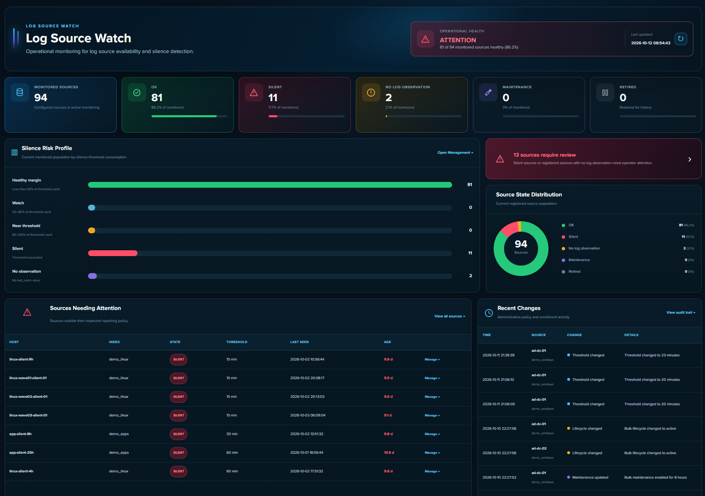

# Log Source Watch

**Know which Splunk log sources should be reporting — and detect when they stop.**

Log Source Watch (LSW) is a Splunk Enterprise app for expected-source inventory, silence monitoring, lifecycle management and first-step failure diagnosis.

A source is identified as a unique `index + host` pair. LSW stores the latest observed event `_time`, applies a source-specific silence threshold, and maintains a canonical operational state.

> **Current status:** 4.9.3 release candidate. The current RC has been runtime-tested for source silence, `_internal` heartbeat correlation, licensing, management workflows and report consistency. GA will follow final packaging/AppInspect validation.



## Why use it?

Splunk can be healthy while a log source you depend on has quietly stopped sending data.

Log Source Watch gives the platform team an explicit answer to three questions:

1. **What should be reporting?** — maintain an inventory of expected `index + host` sources.
2. **Is it still reporting within policy?** — apply a realistic threshold per source instead of one global timer.
3. **Where should investigation start?** — correlate source silence with Splunk `_internal` heartbeat evidence when available.

Typical result:

```text
Source SILENT + _internal ALIVE
→ investigate log generation, input configuration or routing first

Source SILENT + _internal STALE
→ investigate the forwarder, host or connectivity first

Source SILENT + no _internal evidence
→ investigate the source normally; agentless/API/syslog sources may not have heartbeat evidence
```

Heartbeat context is diagnostic only. It does not replace source-specific silence policy.

## Start free with the sources that matter most

Community Edition requires **no license file** and supports up to **100 Monitored Sources** in a qualifying standalone Splunk environment.

That is enough to begin with critical telemetry such as identity, firewalls, VPN, EDR, PAM, security event logs and SIEM infrastructure, tune realistic thresholds and prove the operating model before expanding coverage.

A **Monitored Source** is one unique `index + host` pair whose lifecycle is `ACTIVE` or `MAINTENANCE`. `RETIRED` sources do not consume capacity.

Commercial editions extend capacity and deployment rights without changing the source inventory or workflow model.

See current licensing and pricing at **https://logsourcewatch.com/#pricing**.

## What is included

- explicit expected-source inventory
- source-specific silence thresholds
- canonical states: `OK`, `SILENT`, `NO LOG OBSERVATION`, `MAINTENANCE`, `RETIRED`
- `ACTIVE`, `MAINTENANCE` and `RETIRED` lifecycle management
- timed maintenance and automatic maintenance expiry
- source discovery and controlled enrollment
- bulk policy management
- `_internal` heartbeat-aware diagnosis where Splunk telemetry exists
- operational Overview and Silence Risk Profile
- Silent Sources report
- Application Health report
- Audit Trail for administrative changes
- machine-readable current Silent Sources search and scheduled CSV snapshot
- signed local commercial licensing with in-app status and renewal workflow

## Source age semantics

Source freshness is based on the latest event **`_time`**, not `_indextime`:

```text
last_seen = latest(_time)
age       = now() - last_seen
```

This is deliberate. Delayed or backfilled events with old event timestamps do not make a source appear freshly healthy simply because they were indexed recently.

The Overview also shows early-warning threshold consumption:

- **Healthy margin:** below 50%
- **Watch:** 50% to below 80%
- **Near threshold:** 80% to 100%
- **Silent:** threshold exceeded

`Watch` and `Near threshold` are display-only early-warning bands. They do not create additional source states.

## Quick start

1. Download the latest release `.tgz`.
2. In Splunk Web, open **Apps → Manage Apps → Install app from file**.
3. Restart Splunk when required by the release notes. The current RC includes custom REST configuration, so a restart is expected after installation/upgrade.
4. Open **Log Source Watch → Initial Setup**.
5. Enroll a small set of sources you genuinely expect to report.
6. Set a realistic silence threshold for each source type.
7. Let LSW establish `last_seen`, then test one controlled failure if appropriate for your lab/test environment.

A useful first pilot is 10–50 critical sources rather than importing an entire estate immediately.

## Operational workflow

The normal workflow is intentionally simple:

```text
Expected source registered
        ↓
Latest event observed
        ↓
Threshold policy evaluated
        ↓
OK / SILENT / NO LOG OBSERVATION / MAINTENANCE / RETIRED
        ↓
Optional _internal heartbeat correlation
        ↓
Investigation context
```

The current `LSW_SilentHost` saved search calculates the current Silent Sources list from inventory, last-seen and heartbeat evidence using the same state policy as the user-facing views. The scheduled `lsw_silent_hosts.csv` export is available when a persisted snapshot is preferable.

Planned work should be placed in `MAINTENANCE` so it does not become an avoidable silence investigation.

## Installation requirements

- Splunk Enterprise
- KV Store available
- appropriate access to the indexes you want to monitor
- `admin` / appropriate app administration rights for setup and management workflows

The Splunk app itself does not require third-party Python packages or an external SaaS dependency.

## Documentation

- Public documentation: **https://docs.logsourcewatch.com/**
- In-app technical reference: **Log Source Watch → About**
- Licensing status and renewal: **Log Source Watch → Licensing**

The in-app About page documents the state algorithm, KV Store model, heartbeat behavior, scheduled jobs, management write paths, reports and licensing model.

## Repository layout

```text
app/logsource_watch/       Splunk application source
scripts/                   validation and release tooling
screenshots/               product screenshots
.github/workflows/         CI and release workflows
```

The release builder packages only `app/logsource_watch/` and produces a Splunk-compatible archive with a single top-level `logsource_watch/` directory.

## Validate locally

Windows:

```powershell
py -3 scripts\validate.py
```

Linux/macOS:

```bash
python3 scripts/validate.py
```

## Build a release

```powershell
py -3 scripts\build_release.py --version 4.9.3-rc15
```

Expected output:

```text
dist/logsource_watch-4.9.3-rc15.tgz
dist/logsource_watch-4.9.3-rc15.tgz.sha256
```

## Feedback and testing

The release candidate is specifically useful to test in environments where you already know which log sources are operationally important.

Useful feedback includes:

- source types where silence thresholds are difficult to tune
- hostname/index identity edge cases
- agentless sources with no `_internal` evidence
- delayed or backfilled data behavior
- maintenance/lifecycle workflows
- Search Head topology and upgrade behavior
- UI/report consistency

Please open an issue with reproducible steps and sanitized examples. Do not include production credentials, tokens or customer-sensitive data.

## Security

Do not report suspected vulnerabilities in public issues. See [SECURITY.md](SECURITY.md).

## Licensing

This repository is **source-available, not an OSI open-source project**. Use, deployment, redistribution and commercial rights are governed by [LICENSE.txt](LICENSE.txt).

## Links

- Product: https://logsourcewatch.com/
- Documentation: https://docs.logsourcewatch.com/
- Releases: https://github.com/logsourcewatch/log-source-watch/releases
- Issues: https://github.com/logsourcewatch/log-source-watch/issues

Splunk is a trademark of Splunk Inc. Log Source Watch is independent software and is not an official Splunk product.
